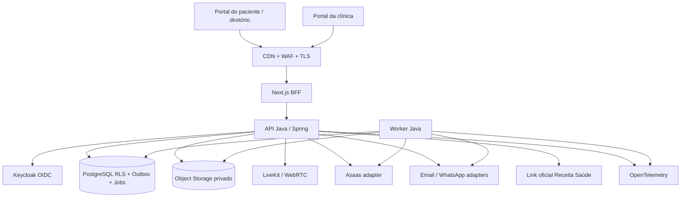

# Psicologia Clínica — Especificação técnica de implementação integral

**Identificador:** PSC-TECH-002  
**Versão:** 2.0.0 · **Data-base:** 2026-10-13 · **Idioma:** pt-BR  
**Status:** baseline de engenharia proposto; requer homologação jurídica, clínica, fiscal e de fornecedores antes do go-live.  
**Leitura obrigatória:** este arquivo, `contracts/openapi.yaml`, `db/schema.sql`, `qa/ACEITE.md`, `ops/OPERACAO.md`, `DECISOES.md` e `contracts/eventos.md` formam um conjunto normativo. Em conflito: `DECISOES.md` define política, este documento define comportamento, OpenAPI define HTTP, schema define persistência, QA define verificação. Abrir ADR de correção antes de implementar uma divergência.

## 0. Escopo e convenções normativas

### 0.1 Objetivo
Construir em **uma entrega de produto completa**, não em MVP parcial, uma plataforma SaaS B2B2C que conecte psicólogos e pacientes e cubra aquisição/agenda, confirmação, remarcação, teleconsulta, prontuário, financeiro, cobrança, documentos, Receita Saúde assistido, materiais, newsletter, blog e relatórios diários. Implementar a solução em **fatias verticais integradas**, sem lançar produção até passar os critérios de aceite globais.

`MUST` = obrigatório para aceite; `SHOULD` = recomendado e exigido se tecnicamente viável sem risco; `MAY` = permitido. IDs estáveis identificam requisitos e decisões. Nenhum requisito com `MUST` pode ser substituído por mock em produção.

### 0.2 Decisões fechadas
| ID | Decisão | Resolução |
|---|---|---|
| ADR-001 | Estilo arquitetural | Monólito modular (Spring Modulith, Java 21 LTS, Spring Boot versão estável compatível fixada por lock de dependências e pipeline) com frontend Next.js/TypeScript, contratos REST/OpenAPI; workers no mesmo codebase em deployment separado |
| ADR-002 | Persistência | PostgreSQL 17+, Flyway, UTC/timestamptz, `tenant_id`, chaves UUIDv7 quando disponível; extensões necessárias somente `pgcrypto`/`btree_gist`; criptografia aplicacional nos campos sensíveis |
| ADR-003 | Tenancy | Uma organização = um tenant; schema compartilhado com RLS `FORCE` e dupla autorização no serviço; contexto de organização por rota validada; clínica nunca compartilha dados com outra |
| ADR-004 | Identidade | OIDC/OAuth2 via Keycloak autogerenciado; Authorization Code + PKCE; BFF de sessão web com cookie `HttpOnly`, `Secure`, `SameSite=Lax`; MFA exigido para equipe; sessões do paciente com proteção adaptativa |
| ADR-005 | Processamento assíncrono | `outbox` + `jobs` em PostgreSQL, consumidor com `FOR UPDATE SKIP LOCKED`, reprocessamento exponencial com jitter e DLQ; sem broker adicional na V1 |
| ADR-006 | Vídeo | LiveKit OSS **autogerenciado em dois nós de rede pública, host networking + Redis de coordenação + TURN/TLS**, no Brasil, via adaptador `VideoProvider`; E2EE obrigatória antes de lançar, token efêmero; gravação, bots, transcrição e IA na sessão **não existem** |
| ADR-007 | Pagamentos | PSP primário Asaas em conta vinculada à clínica; cobrança PIX/boleto/cartão via checkout hospedado, nunca guardar PAN/CVV; reconciliação por webhooks + polling compensatório |
| ADR-008 | Comunicação | Email transacional e WhatsApp Business Platform oficial (templates aprovados e opt-in), abstraídos por `NotificationChannel`; fallback conforme preferências e contingência |
| ADR-009 | Arquivos | S3 compatível, bucket privado, encriptação em repouso + envelope por tenant conforme classificação, URL assinada após autorização; antivírus e quarentena |
| ADR-010 | Receita Saúde | Assistência à emissão e controle manual de recibo externo; nunca declarar emissão concluída sem comprovante/número inserido e validado pelo profissional; nenhuma automação por scraping/credenciais gov.br |
| ADR-011 | Documentos | Modelos aprovados por profissional, PDF/A quando aplicável, trilha de versões, assinatura externa ou integrada somente quando legalmente verificada; sem assinatura simulada |
| ADR-012 | Publicação | Portal privado e diretório público **opt-in**; sem rankear psicólogos por dados clínicos de pacientes; blog/newsletter com opt-in explícito |
| ADR-013 | Operação | Brasil como localidade preferida de processamento/armazenamento; transferências internacionais sujeitas a inventário, análise legal e transparência |
| ADR-014 | Observabilidade | OpenTelemetry + Prometheus + Grafana + logs estruturados; proibir texto clínico, CPF, tokens e querystrings sensíveis |
| ADR-015 | Segurança | Zero trust interna, RBAC + ABAC por vínculo, auditoria imutável lógica, RLS, KMS e segregação administrativa/clínica |

**Não implementar nesta baseline:** diagnóstico por IA, psicometria automatizada, prescrição, prontuário compartilhado irrestrito entre profissionais, marketplace de venda de leads, gravação, transcrição, automação de login gov.br, aplicativos nativos, convênio/TISS, split de pagamentos, chat clínico assíncrono, e emissão fiscal automática. Esses recursos exigem ADR e projeto de conformidade próprio.

### 0.3 Terminologia
- **Organização/tenant:** clínica ou consultório contratante, com ID imutável.
- **Usuário:** identidade global autenticável (`user`), inclusive psicólogo/paciente/funcionário.
- **Paciente:** cadastro clínico pertencente a exatamente uma organização; pode ser vinculado a usuário global para portal. Pode haver cadastros independentes do mesmo indivíduo em várias organizações.
- **Profissional:** membro com papel `PSYCHOLOGIST`, CRP registrado, confirmação administrativa e verificação de registro definida no onboarding. Registro cadastral não é prova automática de regularidade.
- **Vínculo assistencial:** autorização explícita profissional↔paciente (`care_assignment`); não deriva de acesso financeiro nem de ser dono da clínica.
- **Registro clínico:** evolução e prontuário; **material de teste restrito** é armazenado separado, com acesso condicionado a regras profissionais.
- **Fatura:** valor a receber vinculado ao paciente/pagador e opcionalmente sessão; **pagamento:** transação efetiva do PSP ou lançamento manual auditado.
- **Recibo Receita Saúde:** artefato emitido fora da plataforma pelo serviço oficial, apenas referenciado/reconciliado no sistema.

## 1. Arquitetura

### 1.1 Diagrama lógico


### 1.2 Fronteiras de módulos
Código Java em `com.psicocare.{identity,tenancy,patients,scheduling,video,clinical,billing,documents,communications,content,reporting,integrations,audit,shared}`. Cada módulo expõe somente serviços de aplicação e DTOs publicados (`api`); entidades JPA internas não atravessam fronteiras. Uso de `@ApplicationModule` e testes de dependências acíclicas. Fluxo HTTP: controller → auth context → application service → domínio → repository; integrações externas via portas/outbound adapters. Não permitir HTTP entre módulos internos. Worker consome jobs persistidos e chama módulos por interfaces públicas.

### 1.3 Componentes implantáveis e ambientes
| Componente | Replicação de produção inicial | Responsabilidade |
|---|---:|---|
| `web` | 2 | SSR/BFF, proteção CSRF, UI responsive, CSP |
| `api` | 2 | REST, autorização, mutações transacionais |
| `worker` | 2 | jobs/integrações/notificações/relatórios |
| `postgres` | HA gerenciado + réplica/backup | transações, RLS, outbox, relatórios |
| `keycloak` | 2 + BD separado | identidade, MFA, OIDC |
| `video` | 2 nós independentes com IP público + Redis HA | LiveKit SFU, signaling, TURN/TLS sem Egress |
| `object storage` | redundante, privado | documentos, anexos, exportações |
| `telemetry` | observabilidade segregada | métricas e auditoria operacional |

Ambientes `local`, `test`, `staging`, `production` segregados por contas, chaves, domínios, dados, buckets e bancos. **Nunca** clonar dados clínicos reais para `staging` ou `test`. Infraestrutura containerizada, declarativa por Terraform/OpenTofu e Helm/Kustomize; imagens assinadas e imutáveis por digest. Sem deploy manual de hotfix bypassando pipeline. Região de dados no Brasil se comercialmente viável; contratos internacionais aprovados antes de provisionar produção.

### 1.4 API e convenções
- Base `https://api.<dominio>/v1`; HTTPS obrigatório, JSON UTF-8, timestamps ISO-8601 UTC `Z`, datas locais `YYYY-MM-DD`, timezone IANA persistido.
- Routes tenant-scoped: `/v1/orgs/{orgId}/...`. O backend deriva o tenant do **path após validar membership**; nunca confiar em `X-Tenant-Id` arbitrário. Pacientes só acessam registros explicitamente vinculados.
- IDs: UUID em lowercase; dinheiro: inteiro `amountCents` em BRL, não `double`/float; porcentagens inteiras em basis points; paginação `limit` 1..100, `cursor` opaco.
- Escrita `POST` em operações financeiras, agendamentos e efeitos externos exige `Idempotency-Key` UUID. Para autenticados, chave escopada a `(tenant,user,route,key)` + hash de corpo e TTL 72 horas; para ações públicas, escopo `(tenant,requestFingerprint,route,key)` com limitação de tentativas por IP e email verificado, nunca idempotência global apenas pelo IP. Mesmo corpo retorna resultado original, corpo divergente = 409 `IDEMPOTENCY_MISMATCH`.
- `PATCH` do recurso exige `If-Match` com versão (`"v17"`), alteração concorrente retorna 412 `STALE_VERSION`. Sem header 428.
- Erros RFC 9457 `application/problem+json`: `type`, `title`, `status`, `code`, `detail` (sem dados clínicos), `requestId`, `violations[]`; status 400/401/403/404/409/412/422/429/503.
- 401: não autenticado; 403: autenticado sem permissão; 404 para recursos de outra organização/não visíveis (antienumeração). Logs não revelam existência de pacientes.
- Rate limit: 60 req/min/usuário para mutação, 300 leitura; auth/convites 5 tentativas/15min por IP+identificador, refinado após teste de carga. Resposta 429 + `Retry-After`.
- `GET` sem efeitos colaterais. Todas as mutações escritas em banco antes de outbox; side effects após commit. Webhooks autenticados e duráveis antes de ACK.

## 2. Modelo de identidade e autorização

### 2.1 RBAC + ABAC (negação por padrão)
| Ação | OWNER | ADMIN | PSYCHOLOGIST | SECRETARY | BILLING | PATIENT | GUARDIAN | SUPPORT |
|---|---|---|---|---|---|---|---|---|
| Configurar clínica | ✓ | ✓ | — | — | — | — | — | — |
| Cadastrar paciente / dados cadastrais | ✓ | ✓ | ✓* | ✓ | leitura financeira restrita | próprio | dependente autorizado | — |
| Agendar/confirmar/remarcar | ✓ | ✓ | ✓* | ✓ | leitura | próprio conforme política | dependente conforme política | — |
| Financeiro, cobranças, relatórios | ✓ | ✓ | próprio** | conforme concessão | ✓ | próprias faturas | faturas permitidas | — |
| Ver/assinar prontuário | somente se também psicólogo atribuído | somente se psicólogo atribuído | ✓* | — | — | acesso por fluxo formal | condicionado a verificação legal e liberação | — |
| Materiais de teste restritos | somente psicólogo atribuído | somente psicólogo atribuído | ✓* | — | — | — | — | — |
| Emitir documento psicológico | — | — | ✓* | — | — | solicitar/baixar liberado | condicionado | — |
| Editar conteúdo público | ✓ | ✓ | conforme concessão | conforme concessão | — | — | — | — |
| Ver auditoria de segurança | ✓ (sem payload clínico) | limitada | própria | — | financeira | própria | própria | operações sem conteúdo |

`*` exige `care_assignment` ativo; `**` apenas profissionais que sejam credores/recebedores segundo política explícita. Nenhum papel administrativo atribui acesso ao texto clínico. `SUPPORT` da plataforma não possui interface de leitura de conteúdo clínico, inclusive via impersonação; ações excepcionais seguem protocolo break-glass, com justificativa e aprovação de dois administradores, sem acesso a plaintext clínico por padrão.

### 2.2 Atributos obrigatórios de autorização
Em **toda** requisição tenant-scoped validar: (a) usuário ativo; (b) organização ativa; (c) vínculo de equipe ativo e papel **ou** vínculo de portal do paciente/responsável validado para o recurso; (d) recurso pertence à organização; (e) se clínico, atribuição ativa ao paciente; (f) status/legalidade do vínculo paciente/guardião; (g) operação liberada para estado atual. Checagem em service e RLS; negar se qualquer condição falhar. Workers carregam `service_tenant` explícito por job, com escopo mínimo e logs associados.

### 2.3 Cadastro, MFA e convites
- Onboarding clínica: proprietário verifica e-mail, aceita termos e política, cadastra CPF/CNPJ responsável por cobrança, dados da clínica, equipe, política de cancelamento e disponibilidade; exige email verificado e MFA para uso clínico.
- Psicólogo: nome, CRP UF/número, especialidades **autodeclaradas e revisadas**, dados fiscais e de atendimento. Suspender agenda pública se identificação profissional estiver pendente; never afirmar validado automaticamente sem fonte confiável.
- Paciente: convite assinado com nonce de 256 bits, validade 72h, uso único, vinculação explícita ao cadastro e email/telefone confirmado. Sem encontrar pacientes por CPF/email global. Menores: vínculo com responsável, documentos pertinentes e análise de direito de acesso; não presumir que ser pagante concede acesso clínico.
- Recuperação de conta: Keycloak, token efêmero, invalidação de sessões em mudança de fator, logs sem token.

## 3. Especificação funcional por domínio

### 3.1 ORG — Organização, configurações e diretório
**ORG-001**: dados cadastrais, fuso horário padrão `America/Sao_Paulo`, endereço, horários, feriados, políticas e canais. Alterações versionadas em `tenant_settings_versions`; política aplicada ao agendamento é **snapshot** para não alterar contratos passados.  
**ORG-002**: horários de atendimento por profissional; exceções (`availability_exceptions`), ausência/feriado, intervalo mínimo, lead time e limites por dia. Horário padrão não presume disponibilidade.  
**ORG-003**: página pública opt-in com CRP/UF, modalidade, idiomas, tipos de atendimento e valores se autorizados; nenhum dado de paciente, avaliação clínica, diagnóstico ou ranking clínico.  
**ORG-004**: busca por critérios públicos; links de solicitação de agendamento. Pedido inicial cria lead limitado, sem registro clínico até aceitação/adequação.

### 3.2 PAT — Cadastro e portal do paciente
**PAT-001**: paciente com nome social/opcional, nome legal, data de nascimento, CPF opcional até exigência fiscal, contato, canal preferido, endereço opcional, contato de emergência coletado quando indicado, responsáveis e consentimentos. Evitar CPF no URL/log. Dados desnecessários não são obrigatórios.  
**PAT-002**: vínculo paciente↔profissional explícito e histórico de transferência. Transferência não concede automaticamente notas passadas: decisão documentada com profissional/responsável técnico.  
**PAT-003**: portal exibe agenda, status da confirmação, cobranças autorizadas, acesso a sessão, materiais compartilhados, documentos publicados e pedidos de remarcação. Não publica notas clínicas automaticamente.  
**PAT-004**: direitos do titular: solicitações de acesso, correção, portabilidade quando aplicável, revisão e eliminação sob retenção legal. Abrir workflow auditado; não excluir prontuário exigido por obrigação legal mediante clique.  
**PAT-005**: acesso de responsável legal condicionado à relação, situação jurídica e autorização registrada; conflitos geram revisão manual, não decisão automática.

### 3.3 SCH — Agenda, confirmação e remarcação
**SCH-001**: criar sessão avulsa e série recorrente semanal/quinzenal/mensal com data final ou `count<=52`, sempre expandida até 90 dias; job estende horizonte diariamente. Série armazena hora local, timezone IANA e regra RFC 5545 restrita.  
**SCH-002**: horário `[start,end)`; slots de 15min para oferta pública; duração sessão 30..180min múltiplos de 5; impedir sobreposição por profissional em banco, inclusive holds e buffers. Duas sessões para pacientes diferentes não podem começar no mesmo horário com o mesmo psicólogo.  
**SCH-003**: estados `REQUESTED`, `SCHEDULED`, `CONFIRMED`, `IN_PROGRESS`, `COMPLETED`, `NO_SHOW`, `CANCELLED`; `RESCHEDULED` **não é** estado da sessão: sessão antiga vai `CANCELLED` com motivo `RESCHEDULED`, nova recebe `rescheduledFromId`.  
**SCH-004**: solicitações de remarcação próprias (`PENDING`, `ACCEPTED`, `DECLINED`, `EXPIRED`, `WITHDRAWN`); só profissional/secretaria aprovam. Solicitação não libera slot original até aceite atômico; aceitar bloqueia novo slot na mesma transação em que cancela o antigo.  
**SCH-005**: confirmações por tokens de ação assinados/aleatórios, 256 bits, validade até `start - 2h` ou 72h após envio, o que ocorrer primeiro; sessão não permite confirmar após início; um clique idempotente. Um token deve referir unicamente `appointmentId` e ação. Paciente sem conta pode responder ao link por canal verificado sem acesso a prontuário nem links sensíveis.  
**SCH-006**: cancelamento aplica política snapshot (`minNoticeHours`, `chargePercent` etc.). Cancelamentos tardios nunca criam cobrança silenciosamente sem política aceita anteriormente; guardar motivo e ator.  
**SCH-007**: histórico imutável de mudanças (`appointment_history`) contendo estado anterior/posterior, ator, instante, motivo, requestId.  
**SCH-008**: relatórios de agenda por psicólogo/semana; filtros por status, paciente e modalidade, não há dado clínico no relatório administrativo.  
**SCH-009**: DST/fuso: armazenamento UTC; hora local se converte segundo regras IANA; horário inexistente rejeita `422 INVALID_LOCAL_TIME`; horário ambíguo exige offset.  
**SCH-010**: reunião criada automaticamente em `SCHEDULED` para modalidade remota; token gerado apenas no momento de entrar.

#### Tabela de transições de sessão
| Origem | Comando | Destino | Guarda | Side effects |
|---|---|---|---|---|
| `REQUESTED` | aceitar | `SCHEDULED` | psicólogo, slot livre, profissional ativo | confirmação inicial |
| `REQUESTED` | rejeitar | `CANCELLED` | psicólogo/secretaria | notificação sem dado clínico |
| `SCHEDULED` | confirmar | `CONFIRMED` | paciente/vínculo responsável válido, antes de início | histórico, confirmação |
| `SCHEDULED/CONFIRMED` | iniciar | `IN_PROGRESS` | psicólogo vinculado, janela `start-15min` a `end+30min` | token de sala |
| `IN_PROGRESS` | encerrar | `COMPLETED` | psicólogo; horário final real | faturamento conforme contrato |
| `SCHEDULED/CONFIRMED` | registrar falta | `NO_SHOW` | psicólogo, após `start+15min` e até `end+7d` | política de falta |
| `REQUESTED/SCHEDULED/CONFIRMED` | cancelar | `CANCELLED` | ator autorizado, motivo | eventual ajuste financeiro |
| `IN_PROGRESS` | cancelar | inválido | — | `409 INVALID_TRANSITION` |
| estados terminais | alterar | inválido | exceção administrativa auditada via ajuste separado | sem mutação do estado histórico |

**Sem confirmação explícita** a sessão permanece `SCHEDULED`, e pode ocorrer normalmente. Falta é marcada pelo profissional, nunca inferida apenas por ausência de conexão de vídeo.

### 3.4 VID — Sala de atendimento
**VID-001**: uma `video_room` por sessão virtual; nome opaco gerado. Participantes elegíveis psicólogo atribuído, paciente e responsável somente se autorizado expressamente para aquela sessão.  
**VID-002**: token JWT LiveKit emitido por backend TTL 120s para **entrada**, room-bound, identity pseudônima sem PII, grants mínimos de publicação/assinatura. Revogação de autorização deve impedir novas emissões; expulsar participante ao revogar, revisar limitação de auto-hospedagem.  
**VID-003**: profissional pode entrar `start-15min..end+30min`, paciente `start-10min..end+30min`, exceto encerrada/cancelada. Preview câmera/microfone, controles de device, reconnect, indicadores de rede, acessibilidade.  
**VID-004**: E2EE para áudio/vídeo/dados, segredo efêmero por sessão, nunca em logs/BD; distribuição autenticada aos clientes, não via URL. Interoperabilidade entre navegadores definida por matriz de suporte; bloquear lançamento se não houver configuração segura e funcional homologada.  
**VID-005**: não persistir mídia/áudio/vídeo nem transcrição. Metadados operacionais apenas: duração da conexão, falhas de mídia e diagnósticos sem conteúdo.  
**VID-006**: fallback de contingência quando vídeo falhar: mensagem orienta contato por canal combinado entre profissional e paciente, sem divulgar o número pessoal; registrável como incidente de sessão, não auto-redirecionar para canal inseguro.  
**VID-007**: fluxo de atendimento remoto exige no onboarding profissional protocolo para interrupção/risco agudo, localização/contato de emergência quando clinicamente pertinente e orientações de privacidade. Plataforma não oferece serviço de emergência.

### 3.5 CLI — Prontuário e evolução
**CLI-001**: caso clínico criado ao ativar vínculo; uma evolução por atendimento ou registro avulso devidamente identificado. Campos: `occurredAt`, `authorId`, `patientId`, `appointmentId?`, `type`, `narrative`, `plan`, `referrals`, `version`, `status`, `signedAt`, `signedBy`, `sha256`, `previousRevisionId`. Minimização de informação sensível conforme prática profissional.  
**CLI-002**: rascunhos criptografados com autosave a cada 15s/blur; somente autor acessa rascunho; versões concorrentes usam `If-Match`. Rascunho sem assinatura não compõe evolução final.  
**CLI-003**: ao assinar, valida conteúdo obrigatório, cria versão imutável, hash e trilha. Alterações posteriores apenas como **adendo** encadeado; nunca `UPDATE` do texto assinado; hard delete bloqueado.  
**CLI-004**: `clinical_record` (registro compartilhável mediante direitos de acesso) e `restricted_test_material` (protocolos de testes e materiais de acesso profissional restrito) são domínios distintos. Nunca retornar materiais de teste no endpoint normal de prontuário.  
**CLI-005**: anexos via upload de no máx 25MB/tipo PDF/JPEG/PNG; MIME detectado pelo servidor, antivírus, lista permitida, nomes normalizados, storage privado, links 60s. Recusar executáveis/scripts e conteúdo remoto em PDF.  
**CLI-006**: busca textual em narrativa clínica desabilitada inicialmente para evitar índices e vazamentos acidentais; pesquisar pacientes pelos dados cadastrais sob acesso.  
**CLI-007**: pedido de acesso ao prontuário gera pacote auditável preparado por profissional/responsável autorizado, respeitados direitos legais; prazo operacional proposto de resposta até 15 dias, salvo prazo legal específico. Não negar acesso genérico ao prontuário; segregação de material restrito e validação jurídico-clínica obrigatórias.  
**CLI-008**: retenção: não eliminar antes do mínimo aplicável; política mais conservadora de 20 anos após último registro para prontuário eletrônico configurada **provisoriamente** até parecer jurídico, ressalvadas regras distintas de documentos, casos de menores e ordem judicial; legal hold interrompe eliminação. Qualquer expurgo requer autorização de DPO/jurídico/profissional, log e execução verificável.

### 3.6 BIL — Financeiro e cobrança
**BIL-001**: price list por profissional e modalidade, com moeda BRL e vigência; preço de sessão é snapshot no agendamento. Valor 0..2.000.000 centavos, não armazenar `float`.  
**BIL-002**: cada sessão pode originar até uma fatura primária por evento de prestação; faturas adicionais só com ajuste referenciado. Uma fatura pode agregar itens de várias sessões, se todas do mesmo tenant/pagador; ligação `invoice_items`.  
**BIL-003**: estados fatura `DRAFT`, `OPEN`, `PARTIALLY_PAID`, `PAID`, `OVERDUE`, `CANCELLED`, `REFUNDED`, `DISPUTED`; pagamentos `PENDING`, `AUTHORIZED`, `CONFIRMED`, `SETTLED`, `FAILED`, `REFUNDED`, `CHARGEBACK`. Nunca marcar pago por `PAYMENT_CREATED`.  
**BIL-004**: cobrança PSP criada em ambiente da conta clínica mediante `billing_customer_id`, valor/dueDate, `externalReference` ID interno, idempotência persistida em `provider_requests`. Checkout hospedado do PSP; dados de cartão não transitam pelo backend.  
**BIL-005**: webhook `at least once` persistido em `inbox_events` com `unique(provider,event_id)`; após autenticação e ACK, worker consulta estado canônico da cobrança no PSP antes de avançar irreversivelmente, quando houver evento ambíguo. Eventos tardios não retrocedem fatura paga; reembolso/chargeback são transições compensatórias explícitas.  
**BIL-006**: reconciliation a cada 6h de cobranças `OPEN`, `OVERDUE`, `PARTIALLY_PAID` e `DISPUTED`; alerta de divergência. `PAID` exige soma líquida de pagamentos elegíveis maior/igual total; marcar manual exige tipo `MANUAL`, comprovante opcional conforme política, nome de autor e justificativa obrigatória.  
**BIL-007**: ledger de movimentos append-only (`ledger_entries`), dupla entrada não requerida como contabilidade legal mas movimentos de débito/crédito e estornos rastreáveis; valores de fatura nunca alterados após emissão: ajuste gera item compensatório e revisão da fatura ou fatura de crédito.  
**BIL-008**: dashboards de faturado, recebido, vencido, cancelado, estornado e inadimplência por competência e caixa; filtros de período, profissional, forma de pagamento; acesso segundo papel. **Sem prontuário em extrato financeiro**.  
**BIL-009**: pagamento ao profissional e mensalidade SaaS são domínios separados (`practice_billing` vs `platform_subscriptions`). Não reter recursos dos pacientes nem fazer split na baseline.  
**BIL-010**: `payer` pode diferir de paciente (responsável financeiro). Regras de identidade fiscal e recibo são separadas.

### 3.7 GOV — Receita Saúde assistido
**GOV-001**: dashboard de recebimentos elegíveis com indicador `RECEIPT_PENDING`, `EXTERNAL_ISSUED`, `NOT_APPLICABLE`, `REVIEW_REQUIRED`, `VOIDED_EXTERNAL`. Diferenciar pessoa física e pessoa jurídica e casos fiscais.  
**GOV-002**: botão abre **site oficial** em nova aba, sem recuperar/armazenar senha gov.br; tela mostra dados a digitar/copiar individualmente mediante permissão, não faz autofill ou automação oculta.  
**GOV-003**: profissional informa número/identificador do recibo, data, valor, pagador, beneficiário e opcionalmente anexa PDF de comprovante; sistema verifica consistência **local** com recebimento e impede dupla vinculação do mesmo identificador dentro do tenant. A confirmação é declaração do profissional, não validação criptográfica/autoritativa do governo.  
**GOV-004**: cancelamento ou retificação do recibo ocorre no canal oficial, seguido de sincronização manual da referência e histórico.  
**GOV-005**: não alegar integração automática ou emissão oficial sem API, credenciais, autorização e homologação comprovadas. A Receita Federal disponibiliza serviço de Receita Saúde e orientações oficiais; a presente baseline **não presume API pública para terceiros**.

### 3.8 DOC — Documentos psicológicos
**DOC-001**: modelos versionados de declaração, atestado, relatório, laudo e parecer conforme tipologia e requisitos vigentes, com conteúdo final revisado e produzido pelo profissional. **Não gerar automaticamente diagnóstico ou conclusões clínicas.**  
**DOC-002**: editor com campos guiados, preview e geração de PDF rascunho; profissional baixa PDF, utiliza **assinatura externa Gov.br/ICP-Brasil** apropriada e envia o PDF assinado novamente; validação automatizada de assinatura PAdES/ICP-Brasil onde suportada, com revisão humana para os demais casos; emissão em `DRAFT→PENDING_SIGNATURE→ISSUED→REVOKED` com versão e hash. Não alegar validade jurídica específica de um tipo de assinatura não homologado.  
**DOC-003**: toda emissão registra solicitante, paciente, profissional, finalidade, data, assinatura/verificação, distribuição e consentimento/bases legais quando pertinente.  
**DOC-004**: acesso por paciente só após publicação explícita, link autenticado/curta validade; envio por email/WhatsApp contém aviso e link, nunca anexo sensível em canal não aprovado.  
**DOC-005**: documentos psicológicos seguem Resolução CFP nº 06/2019; templates submetidos à validação profissional e jurídica antes do primeiro uso.

### 3.9 COM — Comunicação e relatórios diários
**COM-001**: templates versionados para criação/alteração/cancelamento, confirmação, lembrete T-48h/T-24h (configuráveis), cobrança emitida/paga/vencida, compartilhamento de material e newsletter. Proibir campo clínico nos templates transacionais.  
**COM-002**: separação entre mensagens **transacionais do cuidado** e marketing. Marketing só após opt-in livre, registrável e revogável por canal; opt-out de marketing não bloqueia notificações essenciais justificadas.  
**COM-003**: WhatsApp exige template aprovado e observância da janela de conversa/opt-in; adaptação de provedores sem armazenamento do corpo de mensagens clínicas. Retry 3x (1min, 5min, 30min, jitter) para falhas transitórias; 4xx definitivos vão DLQ com ação humana.  
**COM-004**: `notifications` guarda status `QUEUED/SENT/DELIVERED/FAILED/SUPPRESSED`, canal, template/version, evento correlato e provedores sem conteúdo sensível. Deduplicar por `(tenantId, eventId, channel, templateId, recipientId)`.
**COM-005**: relatório diário gerado às 07:00 no timezone do tenant, janela de eventos **dia local anterior** e status de agenda **dia corrente**, distinguidos explicitamente; confirmação, aguardando, pedido de remarcação, cancelado, não compareceu, horários de hoje e cobrança em aberto. Entrega por email somente com métricas agregadas e link para painel privado.  
**COM-006**: report idempotente `(tenant, date, reportType)`; reproduzir depois com `generatedAt` e snapshot de filtros. Em falha, painel informa `REPORT_DELAYED` e permite regenerar manualmente.  
**COM-007**: nunca inserir nome + tipo de acompanhamento clínico em push, assunto de e-mail ou WhatsApp sem aceite de conteúdo mínimo e contexto adequado.

### 3.10 CNT — Materiais, newsletter e blog
**CNT-001**: biblioteca com pastas, tags não clínicas, versões de arquivo, permissões `PRIVATE_TEAM`, `PATIENT_ASSIGNED`, `PATIENT_SHARED`, `PUBLIC`; paciente precisa compartilhamento explícito e vínculo ativo. Materiais não substituem prontuário.  
**CNT-002**: blog público opt-in por tenant com posts `DRAFT/REVIEW/PUBLISHED/ARCHIVED`, slug único, SEO/meta/og, saneamento HTML e moderação de PII e alegações clínicas.  
**CNT-003**: newsletter com consentimento versionado (data, IP minimizado, origem, conteúdo da declaração); descadastro em um clique; bounce management e limitação de disparos.  
**CNT-004**: métrica de leitura agregada sem perfilar saúde mental; analytics first-party sem cookies desnecessários.

## 4. Transações críticas e consistência

### 4.1 Agendar / evitar double booking
1. Validar acesso, paciente e profissional, consentimentos e política snapshot.
2. Converter horário local para UTC; validar exceções de agenda e sobreposição de buffers.
3. Iniciar transação `READ COMMITTED`, inserir `appointment` com range `tstzrange(start_at-bufferBefore,end_at+bufferAfter,'[)')` e constraint GiST para bloquear overlaps do mesmo `(tenant, professional)` em estados ativos.
4. Inserir `appointment_history`, `outbox_events` e commit.
5. Worker entrega notificação; falha na notificação **não reverte o agendamento**. Conflito PostgreSQL `23P01` vira HTTP 409 `SLOT_UNAVAILABLE`.

### 4.2 Aceitar remarcação
Transação única: lock (`SELECT ... FOR UPDATE`) de solicitação e sessão original; validar `PENDING` e slot proposto; cancelar original `reason=RESCHEDULED`, criar nova sessão e linkage, marcar solicitação `ACCEPTED`, criar history/outbox; commit atômico. Se slot indisponível, rollback integral, solicitação permanece `PENDING`, HTTP 409. Nunca deixar paciente simultaneamente confirmado em dois slots por efeito da remarcação.

### 4.3 Processar webhook de cobrança
Endpoint verifica cabeçalho de autenticação/segredo conforme contrato e configuração do PSP, tamanho <=256KiB, armazena raw payload criptografado com retenção curta sem dados de cartão, deduplica evento; responde 2xx após persistir. Job serializa processamento por `(provider,paymentId)`, usa consulta API se necessário, aplica transição monotônica com compensações, escreve ledger e outbox. Webhook duplicado causa **zero** movimentos adicionais. Se PSP indisponível, retry e alerta, sem marcar pago. Não confiar em ordenação de webhooks.

### 4.4 Assinar evolução
`POST /clinical-notes/{id}/sign` exige MFA recente para ações de assinatura definidas pela política, `If-Match`, autor e vínculo ativo; transação bloqueia nota, computa hash canônico (`canonical-json` UTF-8 dos campos imutáveis), marca `SIGNED`, cria audit hash-chained e outbox `ClinicalNoteSigned` **sem conteúdo clínico**; adendo posterior é outro registro encadeado. Armazenar a data e a identificação de autor; a assinatura interna não equivale automaticamente a certificado digital com validade legal externa.

## 5. Contratos de dados e criptografia
- Campo `tenant_id` em **toda** tabela de negócio; FKs compostas `(tenant_id,id)` impedem relacionamento entre tenants. Índices começam em `tenant_id`, filtrados por status/datas quando conveniente.
- Separar `auth_users` (identidade global, sem conteúdo clínico), `memberships`, `patients`, `care_assignments`, `appointments`, `reschedule_requests`, `clinical_notes`, `restricted_test_materials`, `documents`, `invoices`, `payments`, `receipt_references`, `notifications`, `content_assets`, `audit_events`, `outbox_events`, `inbox_events`, `jobs`.
- Classificação `PUBLIC`, `INTERNAL`, `PERSONAL`, `SENSITIVE_CLINICAL`, `FINANCIAL`; acessar pelo mínimo de privilégio.
- Dados clínicos: criptografar corpo em aplicação com AES-256-GCM usando chave de dados envelopada por KMS por tenant/registro, AAD `(tenantId,table,rowId,revision)`; manter `key_version` e rotação testada. Busca textual no ciphertext desabilitada. PII selecionada (CPF, email, telefone) criptografada em colunas e lookup por HMAC com chave de indexação distinta, sem hash puro de CPF. É proibido revelar plaintext em exceções e telemetry.
- Credenciais PSP, Keycloak, canais e KMS apenas por gerenciador de segredos (`OpenBao KV v2` ou serviço gerenciado equivalente) com identidades de workload; jamais variáveis com segredo em git, manifest ou logs. Rotação sem restart quando adapter suportar.
- Assinaturas de exportação: link único 60s, `Content-Disposition: attachment`, `Cache-Control: no-store`; nenhuma CDN para arquivos clínicos.
- Data retention e legal hold geridos como políticas versionadas por classe; expurgo exige etapa formal de revisão, nunca cron de exclusão automática sem autorização jurídica.

## 6. Segregação de privacidade e segurança

### 6.1 Requisitos de segurança verificáveis
| ID | Regra objetiva | Verificação |
|---|---|---|
| SEC-001 | RLS `ENABLE` + `FORCE` em tabelas tenant; usuário runtime sem BYPASSRLS | consulta catalog + testes cross-tenant |
| SEC-002 | Psicólogo A não lê notas do psicólogo B sem vínculo permitido | API+SQL adversarial |
| SEC-003 | Dono/admin/secretaria sem papel clínico vinculado não leem evolução | testes 403/404 |
| SEC-004 | TLS 1.2+ externo, TLS interno onde possível, HSTS, CSP, cookies restritos | scanner de headers e pen-test |
| SEC-005 | MFA de equipe; autenticação centralizada OIDC/PKCE | testes E2E e desafio |
| SEC-006 | Logs, traces e eventos sem narrativa clínica, CPF, credenciais | DLP canary scan |
| SEC-007 | Todas as mutações financeiras idempotentes + webhook dedup | replay 10x |
| SEC-008 | Backup criptografado diário+PITR; restore ensaiado trimestralmente | evidência de drill |
| SEC-009 | Download documental só após ABAC e link efêmero | teste expiração e revogação |
| SEC-010 | Video sem gravação, transcrição ou sessão pública | inspeção de config e pentest |
| SEC-011 | CSRF no BFF, validação estrita de origem, SSRF mitigado | testes negativos |
| SEC-012 | Segredos fora do repositório, zero exposição em imagem | secret scanning CI |
| SEC-013 | Dependências com SCA, SBOM, builds reproducíveis e imagens assinadas | gates pipeline |
| SEC-014 | DSR e incident response com trilha de auditoria | simulação tabletop |
| SEC-015 | Qualquer acesso emergencial tem dupla aprovação e expiração | teste workflow |

### 6.2 Incidentes e privacy by design
- Definir controlador/operador por operação no contrato comercial e ROPA, pois a clínica é tipicamente controladora de dados assistenciais e o fornecedor processa dados em seu nome, mas algumas finalidades da plataforma podem gerar controladoria própria.
- Bases legais para dados de saúde e de menores são determinadas por finalidade (LGPD arts. 11 e 14); **não** usar consentimento genérico como substituto para todas as bases legais. DPO/jurídico aprova aviso, DPA, RIPD e fluxos de titulares.
- Playbook: detectar → conter → classificar → preservar evidências → analisar risco/dano → jurídico/DPO decidir notificações cabíveis conforme regulamentação ANPD → remediar → pós-morte sem conteúdo clínico. Não afirmar que todo incidente deve ser notificado: avaliar critérios legais.
- Vulnerabilidade crítica explorável: SLA interno triage <= 4h, contenção <= 24h. Esses são **objetivos internos**, não prazos legais.

## 7. Requisitos não funcionais e SLO
| Código | Métrica de aceite | Meta de referência |
|---|---|---|
| NFR-001 | Disponibilidade API mensal (exclui manutenção aprovada) | 99,9% |
| NFR-002 | Latência REST leitura p95/p99 (sem upstream) | <= 400ms / 1200ms |
| NFR-003 | Latência escrita p95/p99 (sem upstream) | <= 700ms / 1800ms |
| NFR-004 | Agenda 100 req/s agregado, 50 clínicas concorrentes, sem double-booking | 0 conflitos persistidos |
| NFR-005 | Webhook confirmado na borda após persistência | <= 2s p95 |
| NFR-006 | Processamento notificação interno | p95 <= 60s após commit (sem SLA de terceiros) |
| NFR-007 | Daily report | até 07:15 da zona local p95 |
| NFR-008 | RPO BD | <= 15 minutos |
| NFR-009 | RTO serviço principal | <= 4 horas |
| NFR-010 | Acessibilidade | WCAG 2.2 AA para fluxos principais |
| NFR-011 | Retenção de logs técnicos | 30 dias, sem clínico; auditoria de segurança 5 anos inicialmente sujeito a política |
| NFR-012 | Relatório conciliação | divergências sinalizadas em <= 6h + margem do PSP |
| NFR-013 | Performance de vídeo | métricas próprias: join success >= 99%, p95 join <= 15s em rede homologada; não é SLA garantido em redes dos usuários |

Dimensionamento de referência, não alegação sobre demanda real: 1.000 clínicas, média 3 profissionais e 25 sessões/semana/profissional = 75.000 sessões/semana, 10.700/dia em média; picos de 15x dimensionam a API. Testes de carga devem validar volume-alvo e capacidade de vídeo separadamente. SLOs dependem de fornecedores e infraestrutura homologada.

## 8. Regras de validação e mensagens de erro
| Código | HTTP | Condição | UX |
|---|---:|---|---|
| `SLOT_UNAVAILABLE` | 409 | concorrência ou bloqueio de disponibilidade | propor outros horários |
| `INVALID_LOCAL_TIME` | 422 | DST horário inválido/ambíguo sem offset | pedir horário válido |
| `INVALID_TRANSITION` | 409 | status incompatível | atualizar tela |
| `STALE_VERSION` | 412 | `If-Match` desatualizado | mostrar comparação/atualizar |
| `CLINICAL_ACCESS_DENIED` | 404 | sem atribuição/vínculo | não revelar existência |
| `CONSENT_REQUIRED` | 422 | consentimento/ciência específico necessário | exibir termo correto |
| `PAYMENT_PROVIDER_UNAVAILABLE` | 503 | indisponibilidade PSP | pendente, nunca pago |
| `EXTERNAL_RECEIPT_NOT_VERIFIED` | 422 | conflito de dados de referência | revisão manual |
| `VIDEO_WINDOW_CLOSED` | 403 | fora da janela ou sessão encerrada | informar janela |
| `DUPLICATE_EVENT` | 200 | webhook válido já recebido | sem side effect |
| `RATE_LIMITED` | 429 | limite por ator/IP | `Retry-After` |
| `UNSUPPORTED_UPLOAD` | 422 | MIME/extensão ou malware | recusar arquivo |

## 9. Requisitos de UX por tela (contrato de comportamento)
| ID | Rota | Campos e ações obrigatórios | Estados específicos |
|---|---|---|---|
| UX-01 | `/login` | login OIDC, MFA, recuperação | carregando/erro/bloqueado |
| UX-02 | `/app/orgs/:id/dashboard` | hoje, próximos, pendências, relatório diário | vazio/indisponível |
| UX-03 | `/app/orgs/:id/agenda` | semana/mês, filtros, disponibilidade, ação criar/confirmar/remarcar/cancelar | loading/empty/conflict |
| UX-04 | `/app/orgs/:id/pacientes` | lista paginada, busca cadastral, convite, detalhar | restricted/no-results |
| UX-05 | `/app/orgs/:id/pacientes/:pid` | contato, agenda, valores conforme papel, materiais | sem permissão |
| UX-06 | `/app/orgs/:id/prontuario/:pid` | evoluções, novo rascunho, assinar, adendo, anexos, pedido de acesso | draft/signed/locked |
| UX-07 | `/app/orgs/:id/financeiro` | faturas, cobrança, reconciliação, filtros, export CSV | pending/disputed/error |
| UX-08 | `/app/orgs/:id/recibos` | elegíveis, status, copiar dados, abrir gov.br, registrar comprovante | external-issued/review |
| UX-09 | `/app/orgs/:id/documentos` | modelos, editor, revisão, emissão, auditoria | draft/pending/issued |
| UX-10 | `/app/orgs/:id/conteudos` | biblioteca, compartilhamento, blog/newsletter | draft/review/published |
| UX-11 | `/app/orgs/:id/configuracoes` | equipe, canais, políticas, MFA, horas e feriados | denied/saved/conflict |
| UX-12 | `/portal` | meus agendamentos, pagamentos, documentos, materiais, preferências | invited/active/expired |
| UX-13 | `/sessao/:appointmentId` | preflight, áudio/vídeo, status, botão sair, ajuda | waiting/joining/live/reconnect/end |
| UX-14 | `/profissionais` | busca por público opt-in, perfil, solicitar horário | slot-taken/pending/hidden |

A UI deve implementar formulário com validação de campo e mensagens acessíveis (`aria-live`), keyboard navigation, timezone explícito, moeda formatada e proteção contra double submit. Não retornar texto clínico em SSR/caches compartilhados. `Cache-Control: private, no-store` em portal e páginas autenticadas.

## 10. Entrega integral e gates de qualidade

### 10.1 Sequência de engenharia (sem releases parciais públicos)
1. Infra, IAM, segredo, ciências de dados, test harness, pipeline.
2. Tenant/usuário/papéis e RLS/ABAC verificável.
3. Paciente, vínculo e agenda com concorrência.
4. Notificações e rapport diária com outbox.
5. Vídeo, acesso temporário e contingência.
6. Prontuário, anexos, documentos e DSR.
7. Financeiro, PSP, recibos assistidos e conciliação.
8. Conteúdo, blog, newsletter, diretório público e portal.
9. Fluxos E2E, segurança, compliance, performance, backup/restore e homologação piloto.

Pode usar feature flags **internas**, mas aceite e lançamento só quando todos os módulos `MUST` concluídos; remover simulações e testes de fornecedor substituídos por integrações homologadas.

### 10.2 Definition of Done global
- Toda rota OpenAPI implementada, autenticação/roles/respostas testadas; nenhuma rota de produção retorna TODO/mock.
- 100% constraints/fks/rls do schema criados por Flyway, sem `ddl-auto=update` em prod.
- Toda transição de estado coberta por teste positivo e negativo; testes E2E das jornadas; cobertura unitária >= 85% em domínios críticos e mutation score >= 70% em scheduling/billing/clinical auth.
- Suíte cross-tenant/clinical ABAC verde, pen-test independente sem crítico/alto aberto, relatório de dependências e SBOM.
- Reconciliação testada com webhooks duplicados, atrasados e fora de ordem; sem cobranças duplicadas.
- Documentos templates e políticas assinados por responsável técnico e jurídico; operação de Receita Saúde claramente rotulada como assistida.
- Consentimentos, termos, aviso, DPA, RIPD quando necessário, política de incidentes e retenção homologados.
- Backup restaurado em ambiente isolado, RPO/RTO medidos e evidenciados.
- Monitoração, on-call, runbooks, alertas e indicadores em funcionamento.
- Accessibility audit WCAG 2.2 AA e testes com usuário concluídos.
- Plano de rollback de deploy/migração, smoke tests pós-deploy e operação manual de contingência ensaiados.

## 11. Questões que não podem ser resolvidas apenas por engenharia
Estas não ficam silenciosamente a critério de agentes de código: precisam de **aceites de domínio e assinatura de decisão** antes de produção, sem bloquear o desenvolvimento dos caminhos conservadores. `GATE-LEGAL-01`: contrato controlador/operador, retenção clínica aplicável e exceções de acesso de responsáveis. `GATE-CLINICAL-01`: templates/documentos e protocolo de emergência remoto validados por psicólogo responsável. `GATE-FISCAL-01`: elegibilidade Receita Saúde PF/PJ por categoria e política de recibos. `GATE-PSP-01`: conta habilitada para API, Pix, webhooks e checkout por clínica. `GATE-VIDEO-01`: E2EE, TURN, browsers, latência e localização de dados homologados. `GATE-BUSINESS-01`: preço de assinatura SaaS, política de cancelamento e percentual de cobrança aceitos pela clínica. Nunca preencher esses campos com presunções que produzam obrigações ou declarações falsas.

## 12. Referências primárias (checadas em outubro de 2026)
- LGPD, Lei 13.709/2018: https://planalto.gov.br/ccivil_03/_ato2015-2018/2018/lei/l13709compilado.htm
- CFP Resolução 09/2024 e orientação CRP: https://transparencia.cfp.org.br/crp16/pergunta-frequente/atendimento-online/
- CFP Resolução 001/2009 e prontuário: https://transparencia.cfp.org.br/crp12/pergunta-frequente/registro-documental/
- CFP Resolução 006/2019 sobre documentos: https://site.cfp.org.br/cfp-publica-versao-comentada-da-resolucao-sobre-a-elaboracao-de-documentos-escritos/
- Receita Saúde: https://www.gov.br/receitafederal/pt-br/assuntos/meu-imposto-de-renda/preenchimento/manual-mir/pagamentos-ou-doacoes/despesas-dedutiveis
- Manual Receita Saúde 2.1: https://www.gov.br/receitafederal/pt-br/centrais-de-conteudo/publicacoes/manuais/orientacao-tributaria/receita-saude-2.1.pdf/view
- ANPD Resolução 15/2024: https://www.gov.br/anpd/pt-br/assuntos/noticias/anpd-aprova-o-regulamento-de-comunicacao-de-incidente-de-seguranca
- Asaas API: https://docs.asaas.com/docs/visao-geral e https://docs.asaas.com/docs/webhook-para-cobrancas
- LiveKit E2EE: https://docs.livekit.io/transport/encryption/
- LiveKit tokens: https://docs.livekit.io/frontends/reference/tokens-grants/
- Assinatura Gov.br: https://www.gov.br/iti/pt-br/assuntos/assinatura-eletronica-avancada

**Atenção:** referências orientam a baseline, mas avaliação de conformidade exige legislação e orientações vigentes na data do lançamento, contratos com fornecedores, validação de fluxos reais e parecer jurídico-clínico.


---

# ADRs, invariantes e política de alteração

## ADR-001 — Monólito modular e separação do worker
**Contexto:** necessidade de velocidade de implementação com qualidade, sem operação distribuída complexa. **Decisão:** Spring Modulith em Java 21 LTS, único repositório e domínio transacional PostgreSQL. Web Next.js + BFF; `api` e `worker` usam mesma base de código, processos diferentes. **Alternativa rejeitada:** microserviços por domínio; alto custo de deploy, transações distribuídas e observabilidade. **Reversibilidade:** publicar eventos versionados permite extração posterior. **Gate:** teste ArchUnit proíbe referências ao pacote `internal` de outro módulo.

## ADR-002 — Tenancy, RLS e acesso clínico
**Contexto:** clínica e profissionais não podem cruzar dados. **Decisão:** tenant por organização com `tenant_id`, FKs compostas, RLS `ENABLE/FORCE`, contexto de sessão por transação e verificação de `care_assignments` nos serviços e RLS do domínio clínico. **Risco:** SQL sem contexto ou conexões reaproveitadas; usar `SET LOCAL` só dentro de transação, nunca `SET` de sessão. **Gate:** cliente banco em produção não é table owner nem BYPASSRLS; testes forçam troca de organização, papel e paciente.

## ADR-003 — Criptografia clínica e separação de dados
**Decisão:** narrativas, materiais de teste, documentos clínicos e anexos protegidos em aplicação (envelope encryption com chave de tenant por KMS), sem índices textuais e sem plaintext em observabilidade. Rotação de KEK reenvolve DEK, sem mudar payload; rotação de DEK exige recriptografia auditada. **Trade-off:** pesquisa clínica full-text não disponível; privacidade prevalece.

## ADR-004 — Agenda transacional
**Decisão:** bloqueio de overlap `EXCLUDE USING gist (tenant_id WITH =, professional_id WITH =, busy_range WITH &&)` para estados ativos, `busy_range` inclui buffers. Remarcação atômica. **Trade-off:** agenda não permite overbooking nem duplicidades de trabalho; override requer fluxo específico não incluído.

## ADR-005 — Cobranças operadas por PSP
**Decisão:** clínicas recebem por conta própria vinculada ao PSP. Plataforma não intermedeia saldo ou cartões. Webhook at-least-once, inbox dedup e consulta de estado canônico, ledger compensatório. **Risco:** onboarding de subcontas e limites do PSP mudam; homologação obrigatória. **Gate:** testes sandbox de cobrança e webhook.

## ADR-006 — Política de sessão clínica
**Decisão:** LiveKit self-host em dois nós com rede pública, Redis HA e TURN/TLS (sem Egress), E2EE obrigatória, sem gravação/transcrição, tokens efêmeros; sem armazenar chave de sala; sem mídia no backend. Vídeo não é prova de comparecimento. **Gate:** teste real multi navegador, TURN, reconexão, bloqueio pós-revogação, medição no Brasil.

## ADR-007 — Prontuário e documentos
**Decisão:** notas assinadas imutáveis; retificação via adendo, materiais de teste segregados; acesso por paciente por fluxo verificável com revisão conforme normas. Templates não produzem conclusões clínicas automáticas. **Gate:** responsável técnico valida termos, formatos e processos de disponibilização e retenção.

## ADR-008 — Receita Saúde
**Decisão:** assistente de dados e navegação oficial, emissão manual, reconciliação assistida. Não realizar OAuth gov.br, scraping, automação de browser, coleta de credenciais nem alegar emissão do recibo no sistema. **Mudança:** nova integração exige evidência de API autorizada + aderência fiscal + ADR.

## ADR-009 — Calendário local e horário de verão
**Decisão:** UTC na persistência, timezone IANA por tenant/sessão, recorrência expressa em hora local, sem ignorar DST; horário inválido recebe erro; ambíguo requer offset. **Gate:** testes em regiões com transições, mesmo que `America/Sao_Paulo` não tenha DST atualmente.

## ADR-010 — Sem IA clínica na baseline
**Decisão:** nenhum processamento por LLM de dados clínicos, nenhum diagnóstico, resumo de sessão ou recomendação terapêutica. **Mudança:** requer novo RIPD, base legal, opção clara, validação clínica, critérios de acurácia, atribuição de responsabilidade e consentimentos quando aplicáveis.

## Invariantes globais executáveis
- INV-01: nenhum recurso de paciente/agenda/financeiro/clínico tem `tenant_id` ausente ou incompatível com o request.
- INV-02: `care_assignment` ativo é requisito para profissional ler/escrever caso clínico.
- INV-03: não há duas sessões ativas com intervalos ocupados sobrepostos para o mesmo profissional.
- INV-04: um pedido de remarcação `ACCEPTED` aponta para exatamente uma nova sessão e a anterior está cancelada.
- INV-05: documento emitido e nota assinada nunca alteram conteúdo original; emenda gera versão/registro distinto.
- INV-06: fatura `PAID` só se conciliação e saldo pagável >= valor da fatura, com métodos manuais explicitamente classificados.
- INV-07: cada evento PSP tem efeito financeiro no máximo uma vez.
- INV-08: um evento de notificação pode gerar no máximo um envio por destinatário/canal/template, exceto reenvio manual auditado.
- INV-09: nenhuma chave de sessão, narrativa clínica, CPF ou token aparece em logs e telemetria.
- INV-10: encerramento de conta não elimina registros sob obrigação de guarda ou legal hold.
- INV-11: papel administrativo não concede acesso a conteúdo clínico sem credencial profissional e vínculo de cuidado.
- INV-12: dados fiscais de recibo apenas acompanham referência oficial, sem aparência de recibo emitido pela plataforma.

## Política de mudança
Qualquer alteração de estado, regra financeira, permissão, retenção, fornecedor, schema ou contrato HTTP exige issue com impacto em `INV`, ADR numerada, migração reversível ou plano expand/contract, atualização OpenAPI/schema/testes, aprovação responsável técnico quando envolver conteúdo clínico, aprovação DPO/jurídico se envolver dados e mudança de política de acesso. É proibida decisão implícita gerada por IA em tema jurídico-clínico.


---

# Guia de execução para equipe ou harness de engenharia

Este guia transforma a especificação em tarefas executáveis. **Não autoriza uso direto em produção sem aprovação jurídica/clínica/PSP/Vídeo.** Todos os módulos MUST serão entregues no mesmo marco de lançamento.

## Monorepo de referência
```text
psico-platform/
  apps/
    web/                  # Next.js TS; app router, sessão BFF, i18n pt-BR
  backend/
    api/                  # Spring Boot app HTTP
    worker/               # Spring Boot worker
    modules/
      identity/ tenancy/ patients/ scheduling/ video/
      clinical/ billing/ receipts/ documents/
      communications/ content/ reporting/ integrations/ audit/
    db/migration/         # Flyway Vxxxx__name.sql
    contracts/            # cópia canônica dos schemas OpenAPI e event JSON schemas
  infra/
    opentofu/             # infraestrutura declarativa
    helm/                 # charts API, worker, web, IAM e vídeo
  test/
    contract/ integration/ e2e/ security/ perf/
  docs/
    adr/ risk-register/ privacy/ runbooks/
  .github/workflows/      # checks, release, security
```

## Stack e critérios de fixação
- Backend Java 21 LTS; Spring Boot estável compatível; Spring Security OAuth2 Resource Server nos fluxos diretos (quando houver) e BFF com OIDC; Spring Data JDBC ou JPA decidido uma única vez pelo responsável técnico; migrations Flyway, Hibernate `ddl-auto=validate` apenas.
- Frontend Next.js estável, React/TypeScript `strict`, Zod para validação e cliente OpenAPI gerado, React Query para cache **somente** de conteúdos não sensíveis e por escopo de organização, Playwright para E2E, Tailwind/shadcn como DS operacional.
- PostgreSQL 17+, Redis HA **obrigatório** para clustering do LiveKit autogerenciado; sem Redis para jobs core. Keycloak + OpenBao, objeto S3, LiveKit autogerenciado (dois nós de rede pública, host networking, UDP/TURN/TLS, sem Egress), Asaas, canal oficial WhatsApp e email transacional homologados.
- Controlar builds via Maven Wrapper / pnpm lockfile e imagens fixadas por digest; versões escolhidas no primeiro PR e registradas em `DEPENDENCIES.lock.md` com compatibilidade/licenças, não usar `latest`.

## Entidades, DTOs, acesso e transações
1. Gerar migrations a partir de `db/schema.sql` **sem executar schema completo novamente em cada ambiente**. Runtime SQL usa papel não proprietário e sem bypass RLS; garantir `SET LOCAL app.tenant_id`, `SET LOCAL app.actor_id` em toda transação, incluindo consultas. Conexão sem contexto deve retornar zero rows, não usar pool session-pinning implícito.
2. Escrever `TenantContextResolver` que valida pertença à organização da rota com JWT verificado via OIDC. Não aceitar tenant do corpo da requisição. `CurrentPrincipal` contém identificador global e membership; papéis são reconsultados no servidor se cache tiver expirado/revogação. Testes revogam membership durante sessões.
3. Gerar DTOs e clientes a partir de OpenAPI. Nenhuma entidade JPA/JDBC exposta por controller. Conversão `amountCents` BigInteger/long e BigDecimal apenas na borda do PSP, com escala 2 e arredondamento não silencioso.
4. Implementar serviço `UnitOfWork` que grava mutação + história + outbox na mesma transação. Jobs e integrações externas **nunca** são executados dentro de lock de transação do agendamento/fatura.
5. Adotar `ProblemExceptionHandler` com erros categorizados e redaction. Logs de app nunca recebem request body completo em endpoints clínicos.

## Ordem em PRs pequenos (um único marco final de produção)
| PR group | Entregável obrigatório | Aceite que destrava |
|---|---|---|
| 01 | Monorepo, devcontainers, DB/migrations, IAM, OpenBao, auth gateway | builds, MFA, RLS isolamento |
| 02 | Organizações, profissionais, políticas, permissões, convites | ORG/PAT e 403/404 |
| 03 | Pacientes, responsáveis, vínculo assistencial, direitos de acesso | PAT-* + SEC-001/002/003 |
| 04 | Disponibilidade, recorrência, agenda, remarcação, confirmação, histórico | SCH-* + T-004..T-007,T-037 |
| 05 | Outbox/Jobs, notificações, templates, preferências, daily report | COM-* + T-023/024 |
| 06 | Vídeo, token room-bound, E2EE, preflight e contingência | VID-* + T-008..T-011 |
| 07 | Notas clínicas, assinatura/adendo, anexos, DSR, acesso ao paciente | CLI-* + T-012..T-015,026/027 |
| 08 | Faturas, pagadores, cobranças, pagamentos, ledger e reconciliador | BIL-* + T-016..T-019 |
| 09 | Recibos externos assistidos, templates/documentos psicológicos | GOV/DOC + T-020..T-022 |
| 10 | Materiais, portal, blog, newsletter, diretório público | CNT/PORTAL + E2E |
| 11 | Segurança independente, carga, restore, pareceres, rollout ensaiado | Gate final integral |

Cada PR deve alterar OpenAPI + domínio + migration + evento + testes + docs se mudou contrato. Para UI de cada domínio criar tests de permission, loading, empty, failure, success, mobile e a11y.

## Casos E2E obrigatórios de ponta a ponta
**E2E-A — Particular online:** psicólogo cria consultório → integra pagamentos e email → define horário/preço/política → publica perfil → paciente solicita horário → clínica aceita e vincula paciente → confirmação → entrada na sala → profissional conclui sessão → assina evolução → sistema gera fatura → paciente paga via PSP → webhook confirmado/settled → recibo fica pendente de emissão oficial → profissional abre Receita Saúde, emite fora do app e registra identificador → paciente recebe documento/materiais liberados. Nenhuma informação clínica chega ao PSP ou comunicação.

**E2E-B — Remarcação e não comparecimento:** agenda semanal → paciente pede remarcação → concorrência por slot gera 409 sem perda do original → aprova alternativa → notifica ambas as partes → horário novo inicia → profissional marca falta apenas com decisão explícita → taxa conforme política previamente aceita → fatura auditável.

**E2E-C — Consultório multiusuário:** dono adiciona secretaria e psicólogo → secretaria agenda e cobra → tenta ler evolução, falha → outro psicólogo tenta ler evolução, falha → autor assina nota → paciente faz pedido formal de prontuário → responsável clínico revisa divulgação → export seguro e auditado.

**E2E-D — Incidentes e recuperação:** PSP envia evento duplicado e fora de ordem → sistema mantém saldo idempotente → vídeo cai → contingência sem perda da agenda → conexão de banco restaurada com PITR → íntegro; nenhum dado sensível em log.

## Política de testes por requisito
`testCaseId` obrigatório na descrição dos testes (ex.: `T-004`). Cada endpoint `openapi.yaml` gera pelo menos smoke test auth+validation; módulos críticos testes de propriedade de máquina de estados e concorrência; integrações possuem fake test adapter mas **produção** aponta para fornecedor homologado com health e circuit breaker. E2E devem ser executados em `staging` com dados inteiramente sintéticos. Não usar snapshots de prontuário real.

## Exemplos de migração e erros proibidos
- Banco exige `tstzrange` e `EXCLUDE`: não substituir por `if (slotDisponivel)` apenas na aplicação.
- Não emitir dupla cobrança para tentar contornar timeout; consultar PSP pelo `externalReference` antes de retry de efeito externo.
- Não reutilizar login da clínica para acessar portal do paciente; vínculos e autorização são contextuais.
- Não permitir query administrativa de clinical_notes ou storage clínico mesmo que tenha `tenant_id` igual.
- Não passar narrativa clínica como payload de evento, push, email, Kafka ou analytics.
- Não oferecer botão “Recibo emitido” se usuário ainda não inseriu identificador externo e comprovou a operação no serviço oficial.
- Não considerar `CONFIRMED` do PSP necessariamente liquidado/irrevogável; considerar bloqueio cautelar, estorno e chargeback.
- Não afirmar que documento PDF sem assinatura comprovada constitui atestado/parecer assinado.

## Perguntas bloqueadoras com defaults seguros
Se clínica não aceita termo de remarcação/cancelamento: **não** cobrar penalidade; se CRP não está revisado: não publicar agenda externa; se conta PSP não está habilitada: permitir somente gestão financeira manual, sem mostrar pagamento online como funcional; se vídeo/E2EE não foi homologado: não abrir teleconsulta pelo sistema; se documentação fiscal não foi aprovada: exibir somente assistente de acesso ao site oficial e sem reivindicação de emissão; se retenção legal não foi aprovada: bloquear exclusão clínica, manter backups e legal hold.

Esses defaults são para manter desenvolvimento seguro, **não** justificam liberar produção afirmando funcionalidades integrais. A versão final exige validação de todos os gates.


---

# Catálogo de eventos de integração e jobs — v1

## Envelope obrigatório
```json
{
  "eventId":"018f6970-1234-7abc-8def-0123456789ab",
  "eventType":"AppointmentScheduled",
  "eventVersion":1,
  "tenantId":"018f6970-1234-7abc-8def-0123456789ac",
  "aggregateType":"appointment",
  "aggregateId":"018f6970-1234-7abc-8def-0123456789ad",
  "aggregateVersion":3,
  "occurredAt":"2026-10-13T14:00:00Z",
  "correlationId":"a37f322b-41b8-4cb1-a2ae-caf63a5b657f",
  "payload":{"appointmentId":"018f6970-1234-7abc-8def-0123456789ad"}
}
```
Todos os eventos contêm **somente IDs e metadados mínimos**; nunca texto clínico, CPF, email ou segredo. `eventId` global único. Schemas de evento versionados; consumidores rejeitam major desconhecida para DLQ e alertam. Campos adicionais são compatíveis, remoção e mudança semântica exigem nova versão.

| Evento v1 | Emissor | Consumidores | Dedup | Observações |
|---|---|---|---|---|
| `PatientInvited` | Patients | Comms | eventId + canal | email com link tokenizado |
| `AppointmentRequested` | Scheduling | Comms, Reporting | eventId | sem criar sala até aceitação |
| `AppointmentScheduled` | Scheduling | Video, Comms | eventId | criar configuração de sala idempotente |
| `AppointmentConfirmed` | Scheduling | Comms, Reporting | eventId | confirmação, sem dado clínico |
| `AppointmentCancelled` | Scheduling | Billing, Comms, Reporting | eventId | política snapshot |
| `AppointmentRescheduled` | Scheduling | Comms, Reporting | eventId | oldId/newId |
| `AppointmentCompleted` | Scheduling | Billing, Reporting | eventId | fatura conforme modo |
| `AppointmentNoShow` | Scheduling | Billing, Reporting | eventId | não inferir pelo vídeo |
| `ClinicalNoteSigned` | Clinical | Audit | eventId | hash, sem narrative |
| `InvoiceIssued` | Billing | PSP, Comms | eventId | emitir cobrança remota via job |
| `PaymentStateUpdated` | Billing | Comms, Reporting, Receipts | eventId | sem dados de cartão |
| `DocumentIssued` | Documents | Comms | eventId | link autenticado |
| `MaterialShared` | Content | Comms | eventId | link de portal |
| `DailyReportRequested` | Reporting | Reporting, Comms | tenant+date+version | job local 7:00 |
| `PrivacyRequestCreated` | Patients | Compliance | eventId | fila sem conteúdo |

## Dispatcher e job engine
`outbox_events`: transação junto ao agregado; worker `SKIP LOCKED` lote 100, `locked_until` 2min, `attempts`, `next_attempt_at`, `status`. Dedup consumidores `consumed_events (handler, eventId)` com índice UNIQUE. Tentativas máximas: 10 para eventos internos, 5 para externos transientes, backoff `min(2^attempt * 30s, 6h)` + jitter; DLQ retém payload sanitizado e requer reprocessamento autenticado. Toda ação externa persistirá comando `provider_requests` com idempotência local antes da chamada, e reconciliação de comandos em estado incerto.

## Webhooks PSP
Endpoint inbound deve validar autenticação do PSP com segredo token/headers conforme contrato oficial ativo, HTTPS e rate limit; não assumir assinatura HMAC inexistente. Persistir evento bruto criptografado, validar tipo e `id` exclusivo, ACK rápido. Eventos desconhecidos são aceitos e registrados como ignorados, com alerta de versão. Mudanças de cobrança resultam em consulta ao PSP quando necessário; `RECEIVED`, `REFUNDED`, chargebacks produzem reconciliação via adaptador e lançamentos compensatórios. Ordem temporal dos callbacks **não é confiável**.

## Scheduler determinístico
- 07:00 timezone da organização: evento `DailyReportRequested` para cada data local, unique `(tenant, local_date, type)`.
- A cada 5min: notificações cujo `due_at<=now()` e estado PENDING.
- A cada 6h: cobrança reconciliation em backlog prioritário.
- Diariamente 02:00 local: expandir séries recorrentes até 90 dias mantendo UNIQUE de ocorrência.
- A cada hora: eventos mortos, jobs atrasados, desbalanceamento contábil, convites expirados; não usar cron para apagar prontuários.
- Ao realizar deploy: scheduler com advisory lock ou leader election DB, e todos os jobs idempotentes.


---

# Plano de testes e matriz de aceite — obrigatório para go-live

## Convenção
Cada cenário tem **Given/When/Then**, evidência automática ou manual, responsável e rastreabilidade. Pipeline executa testes unitários, de contrato, integração PostgreSQL real com Testcontainers, E2E Playwright, DAST, SAST, SCA e smoke de terceiros em sandbox. Fixtures são sintéticas e devem conter canários fictícios para detecção de vazamento.

| ID | Given | When | Then |
|---|---|---|---|
| T-001 | dois tenants e usuário de A | consulta recurso de B alterando UUID/rota | 404; nenhum metadado de B; evento de segurança |
| T-002 | dono de A não psicólogo | consulta nota clínica de paciente de A | 404; nenhuma chave de decrypt é acionada |
| T-003 | psicólogo vinculado P1, não P2 | lê evolução de P2 | 404 e logs sem narrativa |
| T-004 | duas solicitações concorrentes do mesmo slot | ambas criam agendamento | exatamente uma 201 e outra 409; sem duplicata no BD |
| T-005 | remarcação para horário ocupado | aceita pedido | 409; sessão antiga permanece ativa; pedido PENDING |
| T-006 | paciente confirma duas vezes com mesmo link | executa ação | status CONFIRMED uma vez, um evento/outbox, UX sucesso idempotente |
| T-007 | sessão concluída | tentar cancelar/iniciar | 409 sem mutação |
| T-008 | paciente chega 20 min após hora | entrar na sala | permite acesso se dentro janela; não transforma falta automaticamente |
| T-009 | participante tenta entrar sala de outro atendimento | recebe token | 403/404; nenhum token gerado |
| T-010 | sala já encerrada | token antigo/reingresso após revogação | novo token negado; token/participante revogado conforme cenário homologado |
| T-011 | LiveKit indisponível | entrar sessão | mensagem de contingência, agenda íntegra, falha observável |
| T-012 | profissional prepara rascunho | assina | hash e data persistidos, conteúdo posterior imutável |
| T-013 | nota assinada | faz PUT de narrativa | 409; adendo permitido em novo registro |
| T-014 | usuário baixa documento liberado | link expira em 60s | HTTP 403; arquivo não cacheado |
| T-015 | anexo MIME não permitido/executável | upload | 422, quarantine/delete, sem URL de download |
| T-016 | 10 webhooks iguais de pagamento confirmado | processar em paralelo | uma movimentação contábil, uma notificação de pago |
| T-017 | callback de criado chega após recebido | processar | nunca regride PAID para OPEN |
| T-018 | PSP indisponível ao cobrar | criar fatura | fatura aberta e tentativa pendente, não PAID; reprocessa sem duplicidade |
| T-019 | reembolso pós-quitação | callback REFUNDED | estado compensatório e ledger negativo, sem apagar pagamento histórico |
| T-020 | pago por responsável diferente do paciente | gerar recibo assistido | mostrar pagador/beneficiário separados, nunca preencher automaticamente Receita Saúde |
| T-021 | recibo externo não registrado | visualizar financeiro | status `RECEIPT_PENDING`, não exibir recibo oficial inexistente |
| T-022 | usuário marca `EXTERNAL_ISSUED` | sem identificador e data coerentes | 422, requer revisão |
| T-023 | marketing opt-out | campanha newsletter | nenhum envio, transacional permitido conforme política |
| T-024 | relatório diário enviado duas vezes por scheduler | execução concorrente | relatório único `(tenant,local_date,type)` |
| T-025 | auditoria de logger com canários CPF e notas | requests e exceções | zero vazamento em logs/traces/metrics |
| T-026 | paciente pede eliminação de prontuário sob obrigação | DSR | workflow de revisão sem exclusão indevida |
| T-027 | guardião com poder de acesso questionado | solicita prontuário | trava para análise jurídico-clínica, sem exposição automática |
| T-028 | armazenamento de anexos falha após BD salvo | worker reconcilia | referência não publicada sem objeto validado, retry/DLQ |
| T-029 | restore backup isolado | PITR para timestamp selecionado | BD consistente; RPO/RTO demonstrados |
| T-030 | pessoa com teclado/screen reader | percorre cadastro, agenda, sala e checkout | foco/labels/contraste e fluxo WCAG 2.2 AA |
| T-031 | 100 req/s agenda | teste 60min | métricas SLO atingidas, 0 double booking |
| T-032 | carga de 75k sessões/semana extrapolada | soak 24h staging | DB, jobs e P95 dentro de orçamento |
| T-033 | login força bruteforce | 6 falhas em 15min | bloquear/limitar conforme política, sem enumeração de conta |
| T-034 | arquivo clínica armazenado | tentar URL pública do bucket | 403; somente via app autorizado URL efêmera |
| T-035 | secret canary e token em request | inspeção telemetry | redigido; scanner CI aprovado |
| T-036 | nota clínica em material compartilhado de marketing | tentativa de template com campo sensível | rejeitar template e bloquear envio |
| T-037 | série semanal atravessa DST | gerar ocorrências | preserva hora local válida; inválidos sinalizados, sem deslocamento silencioso |
| T-038 | `Idempotency-Key` igual e corpo diferente | POST financeiro | 409 `IDEMPOTENCY_MISMATCH` |
| T-039 | modificar sem `If-Match` | PATCH agendamento | 428 |
| T-040 | paciente de clínica A faz login também em B | alterna portal | vinculações independentes, sem fusão clínica implícita |

## Testes por módulo e rastreabilidade
- `ORG-*`: memberships, política snapshot, lista pública por opt-in, ativação/arquivamento.
- `PAT-*`: convite token uso único, menores/guardião, DSR, limite por paciente.
- `SCH-*`: property-based state machine, horários locais, overlap GiST, race conditions.
- `VID-*`: navegador Chrome/Firefox/Edge/Safari suportado em versão atual, celular; TURN fallback; reconnect; E2EE; dispositivo sem câmera.
- `CLI-*`: adendo, checksum, RLS/ABAC, retenção, teste material segregado.
- `BIL-*`: sandbox PSP, partial payment, late/duplicate/out-of-order webhook, retry e chargeback.
- `GOV-*`: fluxo 100% assistido, dados copiar, nenhuma credencial gov.br no app.
- `DOC-*`: templates homologados, hash, anexos, link autorizado.
- `COM-*`: consentimento marketing, opt-out, template validado, retries, relatórios.
- `CNT-*`: XSS HTML, asset access, newsletter unsubscribe, SEO com dados públicos.

## Critérios para liberar produção (todos, sem exceção)
1. Build de todos os serviços reproduzível no CI; contrato OpenAPI valida e passa contract tests.
2. Teste RLS e ABAC em múltiplos tenants 100% verde e revisado por segurança independente.
3. Não há vulnerabilidade Crítica/Alta aberta nos componentes expostos nem segredo hardcoded.
4. Sandbox PSP cobre criação, conciliação, chargeback, refund e duplicidade.
5. Vídeo possui teste operacional de E2EE, reconnect, TURN e controles de acesso homologados.
6. Modelos clínicos, política de guarda, termos e fluxos fiscais aprovados por especialistas responsáveis.
7. Restore e tabletop incident response documentados; suporte e operação treinados.
8. Usabilidade e acessibilidade aprovadas por participantes reais de consultório e pacientes.
9. Coleta de analytics não persiste dados clínicos; auditoria de DLP verde.
10. Todas as funcionalidades declaradas no escopo estão ativas sem dados/serviços fictícios.

## Evidência de cada execução
O CI deve publicar relatório JUnit, cobertura, mutation testing, DAST, SCA, SBOM, checklist manual assinado, relatório de carga, logs do restore, relatório jurídico-clínico e hash do commit/release. Cada teste crítico vincula ID de requisito e cenário ao PR e ao release.


---

# Operação, implantação e resposta a falhas

## Perfis e controle
- Plataforma com ambientes separados `dev/staging/prod`; acesso de infraestrutura concedido por OIDC + MFA + elevação temporária; deployments automatizados GitOps e revisão de duas pessoas para produção.
- Segredos via OpenBao KV v2 + autenticação por workload; KMS externo ou transit engine com políticas não exportáveis. O OpenBao armazena segredos de fornecedores sem expor chaves a IAs e não substitui arquitetura de autorização dos dados clínicos.
- Nomes de serviços `psico-web`, `psico-api`, `psico-worker`, `psico-keycloak`, `psico-postgres`, `psico-video` (dois nós rede pública com host networking e Redis HA de coordenação), `psico-objectstore`. Namespaces separados por ambiente. Domínios `app`, `api`, `meet`, `auth`, `assets` com DNS e TLS válidos.

## Backup e recuperação
- PostgreSQL PITR com WAL contínuo, backup completo diário e retenção operacional 35 dias; retenção de prontuário não depende **apenas** de backups. Backups imutáveis em conta segregada, protegidos por chave separada.
- Object store versionado, object lock conforme política, replicação de região sujeita a acordo de processamento e requisitos de soberania.
- RPO 15m; RTO 4h alvos testados a cada trimestre. Restore inclui banco, objetos, chaves e configuração declarativa; teste de integridade referências de documentos/objetos.
- Exercício de recuperação trimestral com análise de falha; pelo menos um exercício anual de indisponibilidade total da região.

## Monitoramento e alertas
| Alerta | Threshold proposto | Severidade |
|---|---|---|
| erros 5xx HTTP | >1% em 5min | P1 |
| latência p95 API | >700ms por 15min | P2 |
| DLQ jobs | >0 de módulo clínico/financeiro por 10min | P1 |
| webhook backlog | mais antigo >15min | P2 |
| cobrança divergente | diferença >0 não explicada após 6h | P1 |
| falhas de token/sala | >3% em 10min | P1 |
| backup atrasado | >24h | P1 |
| RLS/auth denial spike | anomalia >= 5x baseline | P1 |
| report diário atrasado | >15min após hora-alvo | P2 |
| expiração segredo/certificado | <14 dias | P2 |

Coletar métricas técnicas (erros, chamadas, duração, tentativas, tamanho de fila) sem nomes de pacientes ou texto clínico. Correlation ID propagado de frontend a worker com `traceparent`, sem expor JWT.

## Runbooks
**R1 PSP instável:** abrir circuit breaker, pausar novas chamadas após salvar intenção local, não alterar estado para pago, verificar status PSP, reconciliação em lote, aviso contextual ao usuário; nunca cobrar novamente sem verificar `externalReference`/pedido anterior.

**R2 vídeo indisponível:** avisar profissional e paciente na tela; manter agenda; direcionar protocolo de contingência previamente acordado; desabilitar tokens quando serviço comprometido; registrar apenas metadados operacionais.

**R3 vazamento suspeito:** preservar evidência com acesso restrito, acionar DPO/segurança, rotacionar chaves e revogar sessões conforme necessidade, avaliar comunicação exigida à ANPD e titulares, não notificar automaticamente sem classificação, documentar prazos e medidas.

**R4 corrupção de schema ou migração:** bloquear rollout, `expand/contract` migrações, escolher rollback de serviço ou restaurar banco se juridicamente/operacionalmente necessário; não apagar migrations aplicadas nem alterar tabela history manualmente.

**R5 erro de agendamento concorrente:** examinar constraint de `busy_range`/status, manter sem compromisso ao usuário até commit, retorno 409 com alternativas; nunca inserir override pela interface administrativa.

**R6 falha de jobs:** verificar locks expirados e attempts; reprocessar evento com mesmo idempotency key; DLQ revisão humana; antes de replay de pagamentos reconciliar PSP.

## CI/CD
`lint -> unit -> architectural-modules -> contract validation -> integration Testcontainers -> security SAST+SCA+secret scan -> E2E -> load smoke -> SBOM+image signature -> deploy staging -> sandbox integration -> approval -> canary production -> postdeploy smoke`. Migrations compatíveis com rollout gradual, feature flags, processo formal de rollback. IaC com plan aprovado; N-1 suporte de contrato web API por 90 dias se lançar versões públicas posteriores.

## Política de dependências
Usar versões estáveis vigentes na implementação, *pinadas*, sem `latest` no Docker ou dependências. PR de atualização com changelog, análise CVE, teste de migração, análise de compatibilidade de Java/Spring/Keycloak/Next/LiveKit, signed artifacts. Não construir dependência em preview sem ADR.

**Vídeo: requisito de rede:** LiveKit multi-node exige Redis; em Kubernetes cada pod usa host networking em nó próprio e portas de mídia públicas com regras restritas, LB para signaling HTTPS, certificado válido em TURN/TLS, observabilidade de jitter/perda e `SIGTERM` draining. Sem serviço Egress/recording implantado. A perda de um nó ativo pode interromper salas nele hospedadas; procedimentos de reconexão e comunicação de contingência devem ser aceitos no teste. Fonte: https://docs.livekit.io/transport/self-hosting/distributed/ e https://docs.livekit.io/transport/self-hosting/kubernetes/.
